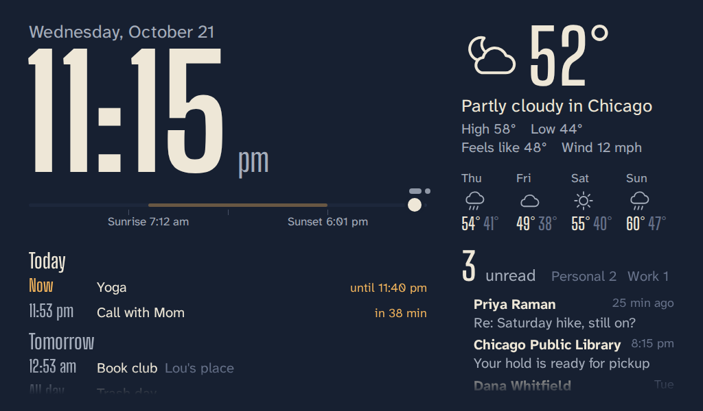

# PiClock



A full-screen clock for a Raspberry Pi that also shows the weather, your next calendar events and your unread email. When new mail arrives it shows who it's from and plays a soft chime (silent overnight). The screen dims at night. On a touchscreen you can tap panels to see more, change every setting on the screen itself, hide the clock to use the desktop, and a small light shows what Claude Code on your PC is doing.

It runs entirely on your Pi. Mail is checked read-only, so nothing gets marked as read. Passwords are stored encrypted.

You'll need a Raspberry Pi running **Raspberry Pi OS with desktop** (not Lite), a screen, and an internet connection.

## 1. The code lives on GitHub

The project is at https://github.com/pouyna/PiClock. The Pi installs from there and checks it for changes every 10 minutes, so pushing to GitHub is how a change reaches the clock. The repository is public, which is fine: your passwords and calendar links live only in `config.ini` on the Pi, and this project never uploads that file.

The working copy on your PC is the `PiClock` folder on the Desktop. Claude Code makes changes there, tests them, and pushes them.

## 2. Install on the Pi (once)

From PowerShell on your PC, log in to the Pi:

```
ssh pi@raspberrypi.local
```

If this is the first time you've logged in, change the well-known default password with `passwd`. Then run this one line:

```
sudo apt install -y git && git clone https://github.com/pouyna/PiClock.git ~/piclock && bash ~/piclock/install.sh
```

It asks for your Pi password once, for `sudo`. The installer sets up everything it needs, starts a background service, turns on updates from GitHub, makes the Pi log in to the desktop automatically, turns off screen blanking, and opens the clock full screen at every login. Reboot once afterwards with `sudo reboot`.

Also check the Pi's time zone is right, or the clock and calendar times will be off: `sudo raspi-config` → Localisation Options → Timezone.

If `raspberrypi.local` doesn't work, use the Pi's IP address instead (find it in your router's device list). If SSH is refused, turn it on in Raspberry Pi Configuration → Interfaces, or put an empty file named `ssh` on the SD card's boot drive.

## 3. Add your weather, calendar and email

**On the touchscreen:** tap the small arrow in the bottom-right corner of the clock, then **Settings**. Tap any value to change it; an on-screen keyboard appears for text. Drag the list up or down with one finger to scroll. To add a mailbox, tap **Add a mailbox**, pick your provider, type the username and app password, and tap **Check sign-in** to try it before saving. **Save and apply** restarts the clock service and shows whether weather, mail and calendar are working. The screen goes back to the clock by itself after a few minutes without taps.

**From your PC instead:** open the settings file over SSH:

```
ssh -t pi@raspberrypi.local piclock config
```

Move around with the arrow keys and paste with a right-click. Save with Ctrl+O, Enter, then exit with Ctrl+X. The clock checks the file for mistakes, restarts, and shows you whether weather, mail and calendar are working. The screen updates on its own within 30 seconds.

Prefer editing in Notepad? Copy `config.example.ini` to `config.ini`, edit it in Notepad, then send it over with `scp config.ini pi@raspberrypi.local:~/piclock/` and run `ssh -t pi@raspberrypi.local piclock restart`. Don't upload `config.ini` to GitHub.

### Weather

Weather comes from Open-Meteo, which needs no account. It's set to Chicago; to change it, right-click your home in Google Maps, click the coordinates to copy them, and put them in `latitude` and `longitude`.

### Calendar

The clock reads your calendar from a private iCal link. Paste each link on its own indented line under `urls =`:

```
urls =
    https://calendar.google.com/calendar/ical/.../basic.ics
    webcal://p01-caldav.icloud.com/published/2/...
```

Where to find the link:

**Google Calendar** (on a computer): Settings → pick your calendar under "Settings for my calendars" → Integrate calendar → copy "Secret address in iCal format".

**iCloud**: in the Calendar app on your iPhone, tap Calendars → the ⓘ next to a calendar → turn on Public Calendar → Share Link. Anyone with this link can see that calendar.

**Outlook.com**: Settings → Calendar → Shared calendars → Publish a calendar → choose the calendar and "Can view all details" → Publish → copy the ICS link.

Treat these links like passwords.

### Email

Uncomment the `[email:Personal]` example (remove the `#` at the start of each line) and fill it in. Add more `[email:Name]` sections for more mailboxes. Use an **app password**, a separate password made just for this device, rather than your normal one:

| Provider | `host` | Where to make an app password |
|---|---|---|
| Gmail | `imap.gmail.com` | Turn on 2-Step Verification, then go to myaccount.google.com/apppasswords. Type it without spaces. |
| iCloud Mail | `imap.mail.me.com` | account.apple.com → Sign-In and Security → App-Specific Passwords. Username is your full iCloud email. |
| Yahoo | `imap.mail.yahoo.com` | Account Info → Account Security → Generate app password |
| Fastmail | `imap.fastmail.com` | Settings → Privacy & Security → App passwords |
| Outlook.com / Hotmail | `outlook.office365.com` | Microsoft has been switching off password sign-in for mail apps, so this may not work. |

### How passwords are stored

Passwords and calendar links are encrypted before they are stored in `config.ini`, where they appear as `enc:...`. Anything you type into the file by hand is encrypted the next time the clock starts. The key lives in `~/.config/piclock/secret.key` on the Pi, readable only by the `pi` user. This keeps the secrets out of casual view and out of copies of the file. Someone with full access to the Pi or its SD card could still read both the file and the key, so keep using app passwords, which you can revoke at any time. If the key file is ever lost, the clock says so and you enter the passwords again in Settings.

## Changing the clock

Make changes on GitHub and the Pi picks them up by itself within 10 minutes. To edit a file, open it on github.com, click the pencil icon, make your change, and click **Commit changes**. Or ask Claude Code to make the change and push it (see below). The screen reloads on its own after each update.

To install a change right away instead of waiting, run this from PowerShell on your PC:

```
ssh -t pi@raspberrypi.local piclock update
```

Each update is tested before it's kept. If a change stops the clock from starting, the Pi goes back to the last version that worked and shows what went wrong. `piclock status` will mention it too. Fix the problem on GitHub and the next change is installed as usual.

Two things to know:

- Make code changes on GitHub, not on the Pi. Updates replace the Pi's copy of the code to match GitHub.
- Your settings are the exception. `config.ini` stays on the Pi and updates never touch it, so keep editing it with `piclock config`.

To update only when you ask, set `auto_update = no` in the `[updates]` section of `config.ini`.

**Prefer a private repository?** The Pi then needs its own read-only key. On the Pi, run `ssh-keygen -t ed25519 -N "" -f ~/.ssh/id_ed25519` and then `cat ~/.ssh/id_ed25519.pub`. Copy the line it prints. On GitHub, go to your repository → Settings → Deploy keys → **Add deploy key**, paste it, and leave write access off. Then install using `git@github.com:pouyna/PiClock.git` in place of the `https://` address, and type `yes` when asked to trust github.com.

## Working on it with Claude Code

Open this folder in Claude Code. It reads `CLAUDE.md` automatically, which explains how everything fits together and the rules to keep the Pi working. Ask for changes in plain words, such as "make the clock bigger" or "add a second time zone". Claude Code can test them, push them to GitHub, and check on the Pi over SSH.

The `dev` folder holds the tests and a preview: `python dev/mock_server.py` shows the clock with sample data at http://127.0.0.1:8099 in your browser, no Pi needed.

## Controlling it from your PC

Log in with `ssh pi@raspberrypi.local`, then use these. The ones marked with `sudo` ask for your Pi password:

| Command | What it does |
|---|---|
| `piclock status` | Shows whether the clock is running and on screen, which version it's on, and whether weather, mail and calendar are working |
| `piclock update` | Install the latest version from GitHub now (`sudo`) |
| `piclock config` | Edit your settings (`sudo` when you save a change) |
| `piclock restart` | Restart after changing files (`sudo`) |
| `piclock logs` | Watch the live log (Ctrl+C to stop) |
| `piclock show` | Open the clock on the Pi's screen |
| `piclock hide` | Close it, so you can use the Pi's desktop |
| `sudo reboot` | Restart the whole Pi |

Type `exit` to leave the SSH session. The clock keeps running.

You can also run any of these straight from your PC without logging in first, for example `ssh -t pi@raspberrypi.local piclock status`.

## Everyday use

On the touchscreen:

- Tap the new-mail alert to dismiss it.
- Tap the mail panel to see more messages, and again for the next page. The agenda works the same way. Both go back to normal by themselves after a minute.
- Tap anywhere at night to brighten the screen for two minutes.
- Tap the small arrow at the bottom right for **Settings** or **Hide the clock**. A hidden clock leaves the desktop free to use. It comes back by itself after 30 minutes (change this in Settings), even if the clock service restarts in between, or sooner when you open **PiClock** from the desktop icon or the menu.
- Claude's mark at the bottom left lights up to show what Claude Code on your PC is doing: green means nothing is running, blue means it is working, yellow means it finished or is waiting for you, red means it hit the usage limit. Tap it for the sessions behind the colour.

With a keyboard plugged into the Pi, **Alt+F4** closes the full-screen clock. Bring it back with `piclock show`, the PiClock icon, or a reboot.

The display settings let you switch to a 24-hour clock, show seconds, change the overnight dimming hours and brightness, or turn off the chime.

## The Claude light

Claude Code on your PC reports what each session is doing through a hook: a small script, `pc/claude_status_hook.py`, that Claude Code runs when you send a prompt, when a tool runs, when it finishes, when it needs your approval, and when it hits a usage limit. The script sends one line to the Pi over the same SSH link you use, and the clock lights Claude's mark at the bottom left green, blue, yellow or red. That line carries the state, the project folder's name and the first line of your latest prompt, which the clock shows when you tap the mark; the Pi keeps it in a file only the `pi` user can read, and it is part of what anyone on your network could see if you ever set "Reachable from" to the whole network. The script prints nothing, never slows Claude down (it runs in the background with a deadline of its own), and keeps nothing on the PC except a small log in `%LOCALAPPDATA%\PiClock`.

It is already set up on this PC: the hooks are in `C:\Users\Pouyan\.claude\settings.json`. To check the link, run this from PowerShell in the project folder; it sends a test report and removes it again:

```
py pc\claude_status_hook.py --test
```

To set it up on another PC: give that PC an SSH key for the Pi (see "Working with the Pi" in CLAUDE.md), put the project folder on it, and add the `hooks` block from `pc/hooks.example.json` to that PC's `~/.claude/settings.json`, with the path to the script changed. The light can be turned off in Settings, under Claude.

## If something isn't working

**Start with** `piclock status`. It names the part that isn't working and why. For more detail, use `piclock logs`.

**Mail says sign-in failed:** double-check the username and app password. For Gmail, make sure it's an app password, not your Google password.

**An update didn't arrive:** run `ssh -t pi@raspberrypi.local piclock update` to see what happens. It will say if GitHub can't be reached or if the new version failed to start.

**`piclock show` says no desktop is running:** the Pi isn't logged in to its desktop. Run `sudo reboot`; the installer set it to log in automatically.

**The clock doesn't open at login:** add the launcher to your desktop's own autostart file. On newer Raspberry Pi OS (labwc), run:

```
echo "/bin/bash $HOME/piclock/kiosk.sh &" >> ~/.config/labwc/autostart
```

On Raspberry Pi OS Bookworm with Wayfire, add this line under the `[autostart]` section of `~/.config/wayfire.ini` (create the section if it's missing):

```
piclock = /bin/bash /home/pi/piclock/kiosk.sh
```

**The screen still goes black after a while:** `sudo raspi-config` → Display Options → Screen Blanking → No, then reboot.

**Want to view it from another computer?** Set `host = 0.0.0.0` in `[server]`, restart, and open `http://raspberrypi.local:8080`. Anyone on your network could then see your mail subjects and calendar. Settings and the hide button still work only on the Pi's own screen.

**The light stays yellow or blue after you closed Claude Code:** a session that ends without saying so drops off by itself (a finished one after 6 hours, a working one after 2). If the light never changes at all, look at `%LOCALAPPDATA%\PiClock\hook.log` on the PC: each line says whether the Pi answered.

**The Settings page doesn't scroll:** drag the list with one finger, anywhere on it. Raspberry Pi OS makes the touchscreen act as a mouse, so a drag doesn't scroll on its own; the Settings page handles it itself since 22 October 2026. If it still doesn't move, the Pi hasn't installed that update yet: `piclock status` shows the version.

**Settings says it can't reach the clock service:** run `piclock status` from your PC. After **Save and apply** the service restarts; give it a few seconds.

## Files

`CLAUDE.md` is the project guide for Claude Code, `dev/` has the tests and preview tools, `app.py` gathers the data, `static/index.html` is the clock screen and `static/settings.html` the settings screen, `settings.py` reads and writes the settings file, `vault.py` encrypts the secrets in it, `claude_status.py` keeps the Claude sessions the PC reports, `pc/claude_status_hook.py` is the hook that reports them, `install.sh` sets everything up, `kiosk.sh` opens the browser full screen, `piclock` is the control command and updater, and `config.ini` (on the Pi only) holds your settings. Fonts are Big Shoulders Display and Atkinson Hyperlegible Next, included under the SIL Open Font License.
